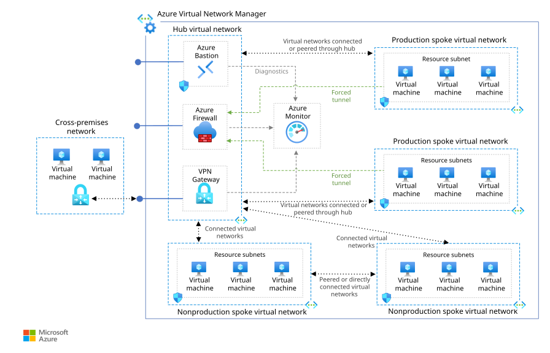
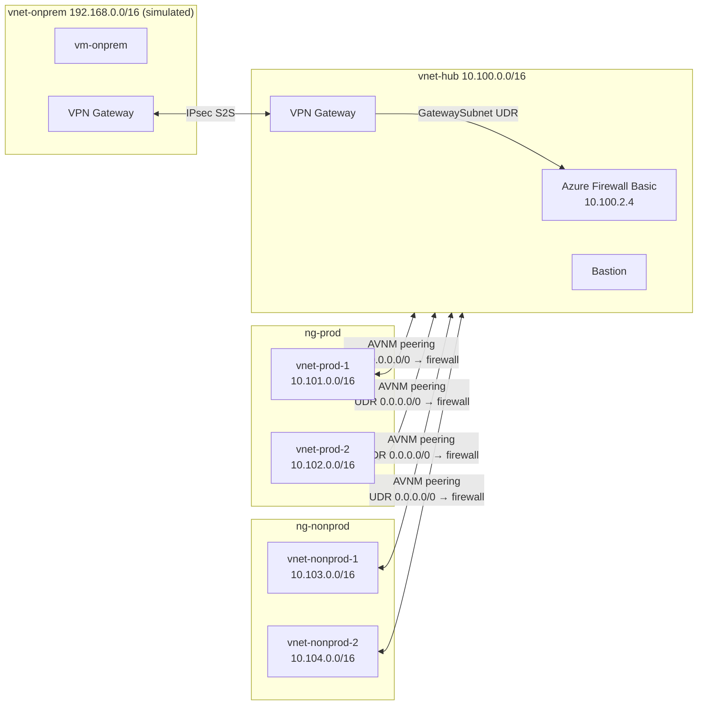
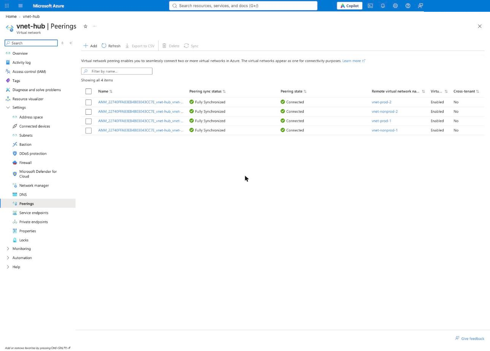
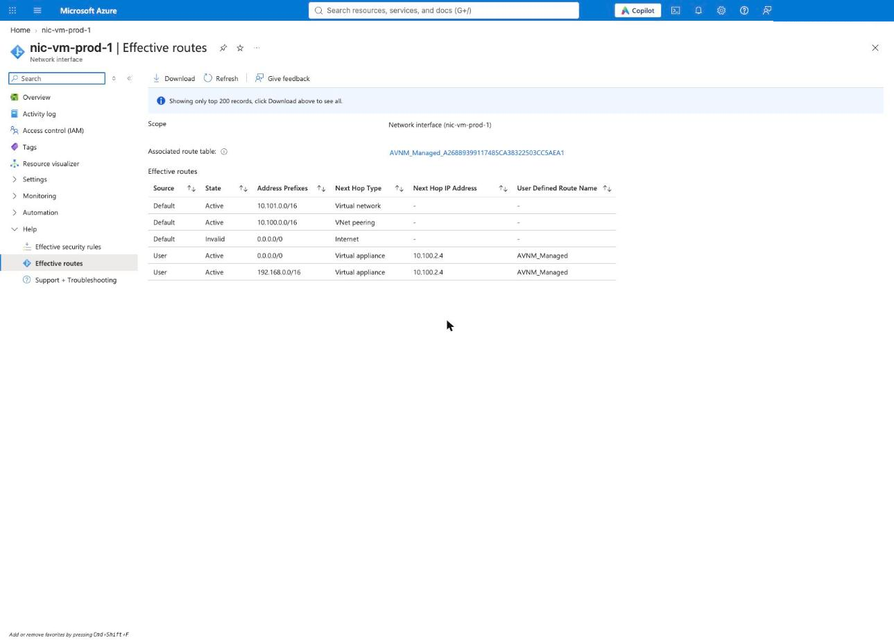
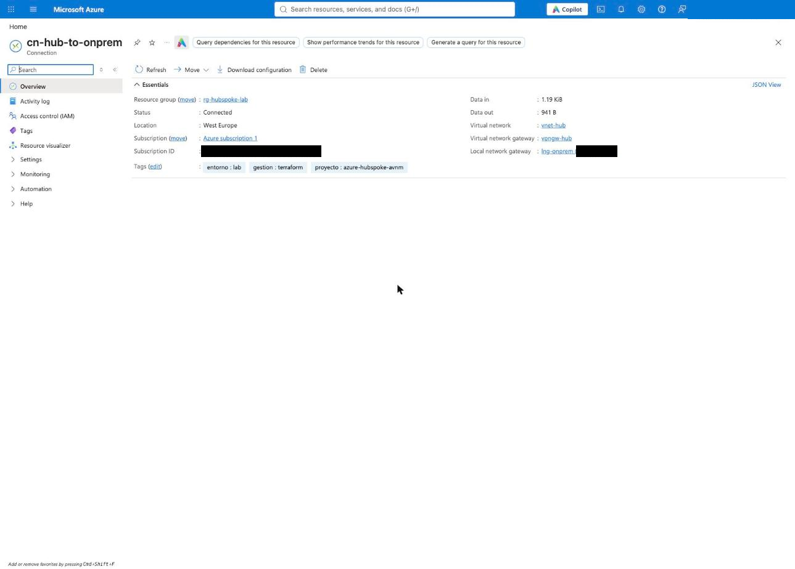
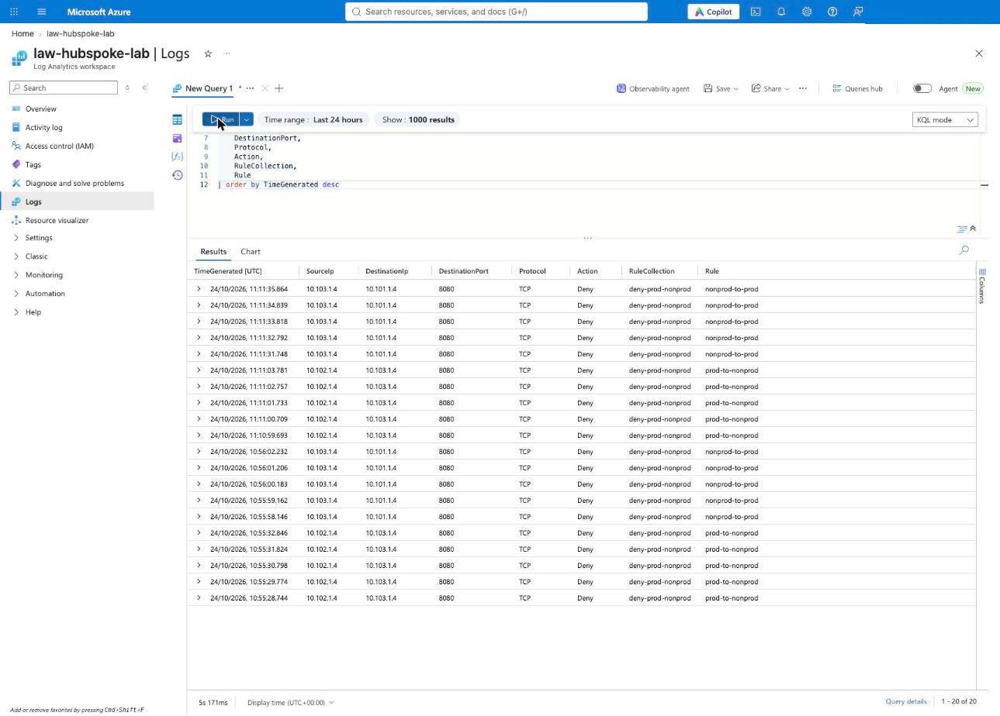

# Azure Hub-and-Spoke with Virtual Network Manager (Terraform)

Hub-and-spoke network on Azure where **Azure Virtual Network Manager (AVNM)** builds the peerings and routes, and **Azure Firewall** inspects all traffic between spokes, to on-premises and to the internet.
Four spokes are segmented into `prod` and `nonprod`, and a simulated on-premises site connects through a site-to-site VPN.
Everything is deployed with Terraform, split into independent stacks with remote state, and validated with an automated connectivity test.

## Reference

This project is a hands-on implementation of Microsoft's
[Hub-spoke network topology in Azure](https://learn.microsoft.com/azure/architecture/networking/architecture/hub-spoke)
reference architecture, built end to end with Terraform.



<sub>Diagram: Microsoft, from the Azure Architecture Center, licensed under
[CC BY 4.0](https://creativecommons.org/licenses/by/4.0/).</sub>

Differences from the reference:

- **Prod / nonprod segmentation** enforced by firewall rules, with an explicit port exception.
- **Spoke routing managed by AVNM** (routing configuration). Only the GatewaySubnet has a classic route table, to keep on-premises traffic symmetric through the firewall.
- **Lab SKUs** (Firewall and Bastion Basic) and a **simulated on-premises site** over site-to-site VPN instead of ExpressRoute.

## Architecture (as built)



| Traffic | Result | Why |
|---|---|---|
| prod ↔ prod, nonprod ↔ nonprod | ✅ Allowed | Through the firewall (no direct spoke peering) |
| prod ↔ nonprod | ❌ Denied | Firewall network rule, priority 200 |
| `vm-prod-1` → `vm-nonprod-1` TCP 8080 | ✅ Allowed | Explicit exception, priority 100 |
| Spokes ↔ on-premises | ✅ Allowed | VPN through the hub gateway; both directions pass the firewall (AVNM UDR + GatewaySubnet UDR) |
| Spokes → internet (HTTP/HTTPS) | ✅ Allowed | Firewall application rule |

## Repository structure

```
config/          shared backend and variable files (*.example committed, real ones git-ignored)
modules/         reusable modules: spoke, vpn-gateway, linux-vm
scripts/         bootstrap, Terraform wrapper, deploy/destroy all stacks, connectivity tests
stacks/          one root module per layer, each with its own state
docs/            design decisions and screenshots
```

| Stack | Contents |
|---|---|
| `00-foundation` | Resource group, Log Analytics, Key Vault (VPN pre-shared key) |
| `10-hub` | Hub VNet, Azure Firewall + policy, VPN Gateway, Bastion, GatewaySubnet route table |
| `20-firewall-rules` | IP Groups and firewall rules |
| `30-spokes` | Four spoke VNets (module `spoke`) |
| `40-avnm` | Network Manager, network groups, connectivity, routing and deployments |
| `50-onprem-sim` | Simulated on-premises VNet, VPN Gateway and S2S connections |
| `60-test-vms` | One Ubuntu VM per network with nginx on port 8080 |

## Usage

**Prerequisites:** Terraform ≥ 1.13, Azure CLI (`az login`), Owner on the subscription, an SSH key in `~/.ssh/id_ed25519.pub`.

```bash
# 1. Remote state (once). Edit the storage account name in the script first:
#    it must be globally unique.
./scripts/bootstrap-backend.sh

# 2. Configuration
cp config/backend.hcl.example   config/backend.hcl     # storage account name
cp config/common.tfvars.example config/common.tfvars   # subscription id, region
# and copy terraform.tfvars.example → terraform.tfvars in each stack

# 3. Deploy all stacks in order (asks for confirmation on each plan)
./scripts/deploy-all.sh

# 4. Validate the network behaviour
./scripts/test-connectivity.sh

# 5. Destroy everything except 00-foundation
./scripts/destroy-all.sh
```

To work on a single stack, `tf.sh` adds the backend key and shared variables:
`./scripts/tf.sh 10-hub plan`.

> The VPN gateways take 30–45 minutes to create. Stacks must be applied sequentially:
> changing the firewall policy while the firewall is being created can leave it in a failed state.

## Validation

`scripts/test-connectivity.sh` runs `curl` from inside each VM (`az vm run-command`, no SSH)
and compares the result with the expected firewall behaviour. Last run: **13/13 passed**.

| Test | Expected | Result |
|---|---|---|
| nginx listening on 8080 in all 5 VMs | ok | ✅ 5/5 |
| prod-1 → prod-2 :8080 | ok | ✅ |
| nonprod-1 → nonprod-2 :8080 | ok | ✅ |
| prod-1 → nonprod-1 :8080 (exception) | ok | ✅ |
| prod-2 → nonprod-1 :8080 | blocked | ✅ |
| nonprod-1 → prod-1 :8080 | blocked | ✅ |
| onprem → prod-1 :8080 | ok | ✅ |
| prod-1 → onprem :8080 | ok | ✅ |
| prod-1 → internet :443 | ok | ✅ |

The first run failed 3 tests and exposed two real issues, both fixed:
asymmetric routing for on-premises traffic (fixed with the GatewaySubnet route table)
and no internet access in the simulated office (needed by cloud-init to install nginx).

<details>
<summary>Screenshots</summary>

**Peerings created by AVNM**


**Effective routes of a spoke VM: default and on-premises traffic to the firewall**


**Site-to-site VPN connected**


**Denied prod ↔ nonprod traffic in the firewall logs**


</details>

## Cost

Running the full lab costs **about €1/hour** (mostly Azure Firewall Basic, two VPN gateways and Bastion).
`00-foundation`, the VNets and the IP Groups cost practically nothing when idle.
Destroy the paid stacks after testing.

## Design decisions

See [docs/decisions.md](docs/decisions.md): stacks, cross-stack references, firewall policy, AVNM, secrets and lessons learned.