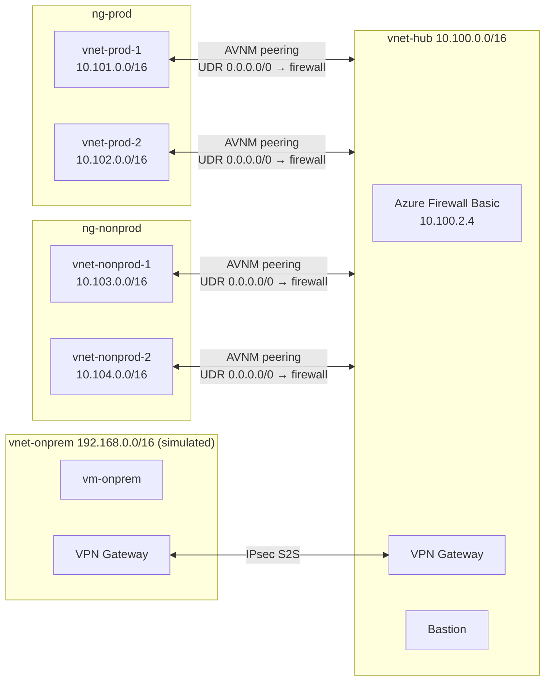

# Azure Hub-and-Spoke with Virtual Network Manager (Terraform)

Hub-and-spoke network on Azure where **Azure Virtual Network Manager (AVNM)** builds the peerings and routes, and **Azure Firewall** inspects all traffic between spokes, to on-premises and to the internet.
Four spokes are segmented into `prod` and `nonprod`, and a simulated on-premises site connects through a site-to-site VPN.
Everything is deployed with Terraform, split into independent stacks with remote state.

## Reference

This project is a hands-on implementation of Microsoft's
[Hub-spoke network topology in Azure](https://learn.microsoft.com/azure/architecture/networking/architecture/hub-spoke)
reference architecture, built end to end with Terraform.


<sub>Diagram: Microsoft, from the Azure Architecture Center, licensed under
[CC BY 4.0](https://creativecommons.org/licenses/by/4.0/).</sub>

Differences from the reference:

- **Prod / nonprod segmentation** enforced by firewall rules, with an explicit port exception.
- **Routing managed by AVNM** (routing configuration) instead of manually maintained route tables.
- **Lab SKUs** (Firewall and Bastion Basic) and a **simulated on-premises site** over site-to-site VPN instead of ExpressRoute.

## Architecture (as built)



| Traffic | Result | Why |
|---|---|---|
| prod ↔ prod, nonprod ↔ nonprod | ✅ Allowed | Through the firewall (no direct spoke peering) |
| prod ↔ nonprod | ❌ Denied | Firewall network rule, priority 200 |
| `vm-prod-1` → `vm-nonprod-1` TCP 8080 | ✅ Allowed | Explicit exception, priority 100 |
| Spokes ↔ on-premises | ✅ Allowed | VPN through the hub gateway, inspected by the firewall |
| Spokes → internet (HTTP/HTTPS) | ✅ Allowed | Firewall application rule |

## Repository structure

```
config/          shared backend and variable files (*.example committed, real ones git-ignored)
modules/         reusable modules: spoke, vpn-gateway, linux-vm
scripts/         bootstrap-backend.sh (remote state), tf.sh (Terraform wrapper)
stacks/          one root module per layer, each with its own state
docs/            design decisions, incident report and images
```

| Stack | Contents |
|---|---|
| `00-foundation` | Resource group, Log Analytics, Key Vault (VPN pre-shared key) |
| `10-hub` | Hub VNet, Azure Firewall + policy, VPN Gateway, Bastion |
| `20-firewall-rules` | IP Groups and firewall rules |
| `30-spokes` | Four spoke VNets (module `spoke`) |
| `40-avnm` | Network Manager, network groups, connectivity, routing and deployments |
| `50-onprem-sim` | Simulated on-premises VNet, VPN Gateway and S2S connections |
| `60-test-vms` | One Ubuntu VM per network with nginx on port 8080 |

## Usage

**Prerequisites:** Terraform ≥ 1.13, Azure CLI (`az login`), Owner on the subscription, an SSH key in `~/.ssh/id_ed25519.pub`.

```bash
# 1. Remote state (once). Edit the storage account name in the script first:
#    it must be globally unique.
./scripts/bootstrap-backend.sh

# 2. Configuration
cp config/backend.hcl.example   config/backend.hcl     # storage account name
cp config/common.tfvars.example config/common.tfvars   # subscription id, region
# and copy terraform.tfvars.example → terraform.tfvars in each stack

# 3. Deploy in order (tf.sh adds the backend key and var-file for each stack)
for s in 00-foundation 10-hub 20-firewall-rules 30-spokes 40-avnm 50-onprem-sim 60-test-vms; do
  ./scripts/tf.sh "$s" init
  ./scripts/tf.sh "$s" apply
done

# 4. Destroy in reverse order (keeping 00-foundation is optional and almost free)
for s in 60-test-vms 50-onprem-sim 40-avnm 20-firewall-rules 30-spokes 10-hub; do
  ./scripts/tf.sh "$s" destroy
done
```

> The VPN gateways take 30–45 minutes to create. `10-hub` must finish before `40-avnm` (gateway transit) and `50-onprem-sim`.

## Validation

_Results of the connectivity tests: pending, to be added after deployment._

## Cost

Running the full lab costs **about €1/hour** (mostly Azure Firewall Basic, two VPN gateways and Bastion).
`00-foundation`, the VNets and the IP Groups cost practically nothing when idle.
Destroy the paid stacks after testing.

## Design decisions

- [Design decisions](docs/decisions.md): stacks, cross-stack references, firewall policy, AVNM and secrets.